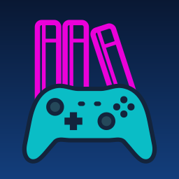
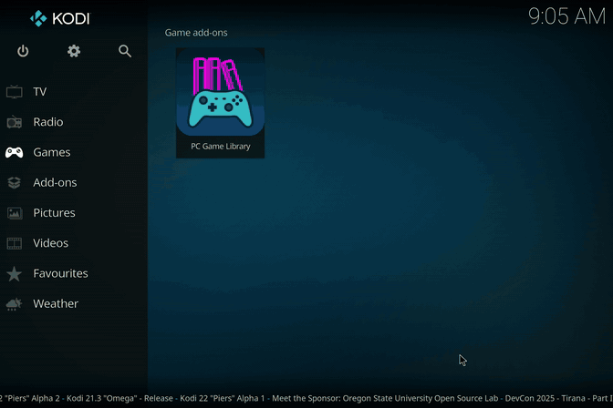

<p align="center">
  
</p>

<h1 align="center">PC Game Library for Kodi</h1>

<p align="center">Find and launch your installed Windows games from Kodi 19 or newer.</p>

<p align="center">
  <a href="#install-and-use">Installation</a> ·
  <a href="#what-it-finds">Supported games</a> ·
  <a href="#development">Development</a>
</p>

<p align="center">
  
</p>

## Install and use

1. Download the add-on ZIP from Releases, not the source code ZIP.
2. In Kodi, choose **Add-ons → Install from zip file**. Enable **Unknown sources** if prompted.
3. Open **Games → PC Game Library**. If Games is hidden in Estuary, enable it under **Settings → Interface → Skin → Configure skin → Main menu items**.

The first open indexes games in the background. Later opens use the saved list. After installing or removing games, choose **Rescan installed games** from a tile’s context menu.

In Estuary, the library opens in horizontal Poster view with the most recently launched game selected. Xbox app and Game Bar shortcuts stay at the top. Use **Add to favourites** on the add-on tile for home-screen access.

## What it finds

- **Steam and Epic Games:** Installed games from launcher manifests.
- **GOG Galaxy, Ubisoft Connect, and EA/Origin:** Supported desktop and Start Menu shortcuts.
- **Standalone games:** `C:\Games`, both Program Files folders, and `%LOCALAPPDATA%\Programs`. Ambiguous installs are skipped.

Missing posters and widescreen covers are downloaded from Steam during indexing and cached in Kodi’s add-on profile. For non-Steam installs, the add-on searches Steam by title and only uses a unique exact match. It never writes artwork to game folders. If no poster is found, the tile uses an icon.

Custom backdrops live in [`hero_images.json`](plugin.game.installedgamelibrary/resources/hero_images.json). For standard Steam art, the add-on builds the CDN URL from the app ID. [`steam_titles.json`](plugin.game.installedgamelibrary/resources/steam_titles.json) preserves aliases and edition IDs for matching. Both files together cover over 100 titles; neither adds emulator discovery.

Changes trigger a reindex. Portraits stay on the tiles, and missing backdrops are blank. In Estuary, enable **Configure skin → Artwork → Show media fanart as background** if needed.

The Xbox app and Game Bar have separate Xbox-branded posters and a shared backdrop, with bundled artwork if Windows can’t supply the logo. Game Bar uses **Win+G**; try windowed mode if the overlay doesn’t appear.

## Development

Using an AI agent is highly encouraged as it will auto build the plugin to be installed.

```powershell
uvx ruff check --fix
uvx ruff format
uv run --python 3.11 --no-project python -B -m unittest discover -s tests -v
python -m zipfile -c plugin.game.installedgamelibrary-0.10.1.zip plugin.game.installedgamelibrary
```

[Local hero-image backup manifest](artwork/Game%20Hero%20Images/hero-image-backup.json) · [Cyberpunk Neon Palette](https://www.color-hex.com/color-palette/61235) · [IGDB](https://www.igdb.com/) · GPT 6.2 Sol · pi agent · [video game artwork](https://hdqwalls.com/shadow-of-the-colossus-8k-wallpaper)
